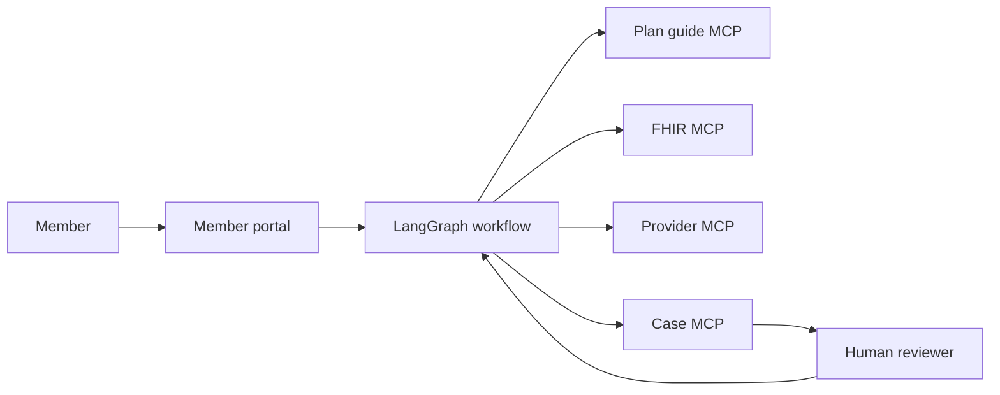

# Health Plan Agentic Member Journey Lab

Synthetic member portal for a health-plan engagement lab. Members can ask about benefits, claim amounts, and in-network care. A billing review stays pending until a human reviewer approves it. A voice journey sends a transcript into the same claim path.

`SYNTHETIC_MEMBER_DATA_NOT_A_HEALTH_PLAN`

This tree does not connect to a health plan, a clearinghouse, or a patient system. The people, clinics, plan guide, and explanations of benefits are fixtures. Nothing here is a coverage determination, a bill, or medical advice.

The full blueprint specifies PostgreSQL, pgvector, Keycloak, React, Synthea-scale data, OpenTelemetry, and Kubernetes. This tree is the local subset that runs here: FastAPI, LangGraph, the MCP Python SDK, FHIR-shaped JSON, and SQLite. What is implemented and what is not is in [docs/blueprint-status.md](docs/blueprint-status.md). The running design is in [docs/architecture.md](docs/architecture.md).

## Journeys

| Journey | Member question | What the lab does |
| --- | --- | --- |
| Benefits | Is physical therapy covered, and how many visits? | Plan-guide section 5.1 plus a count of 2026 physical-therapy explanations of benefits. |
| Claims | Why do I owe $85 for my urgent care visit? | Section 4.2 copay of $75 plus the $10 deductible adjudication on EOB DEMO-1048. |
| Care | Find in-network cardiology options. | Provider directory filtered to in-network cardiology, with the section 6.1 specialist copay. |
| Action | Open a billing review request. | Creates a pending case. A reviewer has to approve it before the open tool runs. |
| Voice | Can you explain my latest claim? | Browser transcript in. The server explains the latest explanation of benefits. |

The $85 question is answered as $75 plus $10 because those are the record amounts. The model is not allowed to choose them. Partial payment is a second claims path: EOB DEMO-2201.

## Architecture



LangGraph routes each question to a specialist node. The nodes call MCP tools. FHIR resources are R4-shaped JSON in the tenant bundle, including `ExplanationOfBenefit` adjudication and CARIN coinsurance codes. Retrieval is lexical and returns the plan section id with the text. Citations in the answer are those section ids and the resource ids the numbers came from.

A billing review is two transitions. `request` stores `pending_approval` and the graph interrupts. `open` runs only after a reviewer has stored `approved`. The member token cannot approve.

## Local run

Python 3.12. From this directory:

```powershell
& "C:\Users\Jatin\AppData\Local\Programs\Python\Python312\python.exe" -m venv .venv
.\.venv\Scripts\python.exe -m pip install -e ".[dev]"
.\.venv\Scripts\python.exe -m pytest
.\.venv\Scripts\python.exe -m membercare.evals
.\.venv\Scripts\python.exe -m membercare --host 127.0.0.1 --port 8765
```

The portal is `http://127.0.0.1:8765/`. The lab actor list is loaded from the fixtures. `demo-member` is Alex Rivera on Synthetic PPO 2026. `demo-reviewer` approves billing reviews. `other-member` is a second tenant used to show isolation.

Member reads are also on `/api/v1/me`, `/api/v1/me/coverage`, `/api/v1/me/eobs`, and `/api/v1/me/eobs/{id}`. A service date outside plan year 2026 returns `plan_year_mismatch` and no coverage body. Explanation-of-benefit amounts are decimal strings taken from the adjudications. DEMO-1048 is $250 submitted, $180 eligible, $95 plan paid, and $85 member responsibility.

`POST /api/v1/assistant/runs` starts the same workflow as chat. `POST /api/v1/voice/transcribe` accepts a transcript and sets `server_speech_recognizer` to `not_used`. MCP tool names and the response envelope are in [docs/mcp-contracts.md](docs/mcp-contracts.md).

More operational detail is in [docs/runbook.md](docs/runbook.md). Evaluation rules are in [docs/evaluation.md](docs/evaluation.md). The threat boundaries are in [docs/threat-model.md](docs/threat-model.md).

## Amounts

Every member dollar amount is integer cents taken from the plan-guide facts or from explanation-of-benefit adjudications.

An explanation of benefits is refused when item totals and claim totals disagree, when a required adjudication code is missing, or when the eligible amount is not the benefit plus copay, deductible, and coinsurance. Urgent-care answers also require the explanation-of-benefit copay to equal section 4.2.

The default sentence is a template. A wording pass can call the xAI Responses API only when `MEMBERCARE_NARRATION=llm` and `XAI_API_KEY` are both set. That call uses `https://api.x.ai/v1/responses`, model `grok-4.7`, and `store: false`. The template is kept if the dollar amounts change. The tests do not set the key and do not make that call.

## Voice

The server accepts a transcript. It does not run a speech recognizer. The browser page uses the browser recognizer when one exists, and the response field `server_speech_recognizer` is `not_used`.

## Observability and recovery

`/metrics` publishes counters for journeys, tool calls, approvals, and permission denials. Labels do not include a member id. Each turn is stored in SQLite with its thread id, journey, narration mode, and latency.

The paused billing review is stored twice: the case row, and the LangGraph checkpoint. A new process can approve the same case id. Tests cover that restart.

## What was run on this workstation

Python 3.12.10. The installed packages used for the run included langgraph 1.2.24, mcp 2.3.0, and fastapi 0.165.0.

`python -m pytest` reported 25 passed in 5.07 seconds. `python -m membercare.evals` reported 5 of 5 journeys passed.

The portal was then started on `127.0.0.1:8765`. HTTP checks against that process returned the urgent-care sentence ($75 copay and $10 deductible, EOB DEMO-1048, section 4.2), the physical-therapy visit count (20 allowed, 4 in 2026, 16 remaining), the partial-claim amounts on DEMO-2201, the two in-network cardiology offices, the voice transcript answer for the latest claim, and billing review CASE-0001 still pending. A member decision returned HTTP 403. The reviewer decision returned HTTP 200 and the case status became `open`.

No browser tool was available, so the page buttons were not clicked. The HTML and script were fetched, and the same journeys were submitted as HTTP requests.

## Honesty limits

- No live health-plan or FHIR server was connected. The FHIR data is fixture JSON served by this lab's MCP server.
- No vector database was run. Retrieval is lexical.
- No server-side speech recognizer was run.
- The optional xAI wording call was not made during the build.
- Docker is not installed on the workstation that added this tree. The Dockerfile and docker-compose.yml were not built or run.
- PostgreSQL, pgvector, Keycloak, React, Synthea, OpenTelemetry, Grafana, Jaeger, and Kubernetes were not run. See [docs/blueprint-status.md](docs/blueprint-status.md).
- The GitHub Actions workflow was written and was not observed from this workstation.
- The public repository is https://github.com/JatinF/health-plan-agentic-member-journey-lab.
- Lab bearer tokens are fixtures checked into the repo. They are not an identity provider and must not be reused for real member data.

## Layout

```text
src/membercare/          portal, LangGraph workflow, MCP servers, amount math
src/membercare/data/     synthetic actors, plan guides, FHIR bundles
web/                     member portal
tests/                   journey, member API, MCP contract, checkpoint, and stdio tests
docs/                    architecture, blueprint status, MCP contracts, evaluation, runbook, threat model
```

## License

MIT. Copyright (c) 2026 Jatinder Singh.
