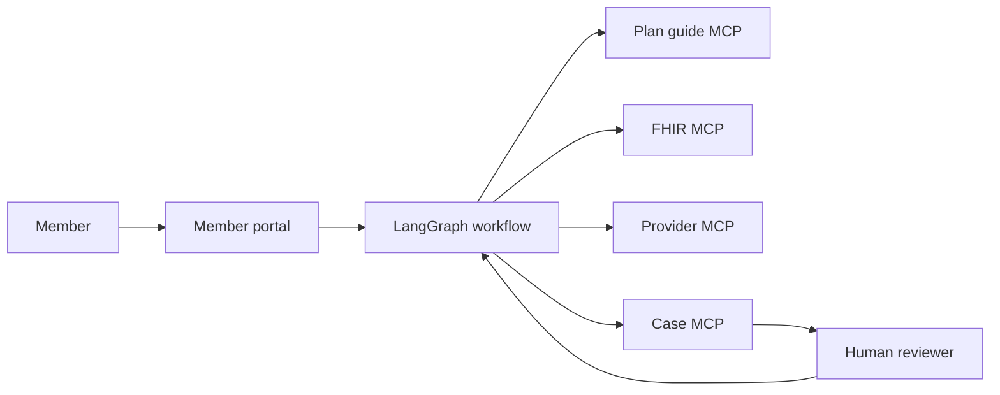

# Architecture

The full blueprint names PostgreSQL, pgvector, Keycloak, React, Synthea, OpenTelemetry, and Kubernetes. Those parts are not what this process runs. This document is the architecture that is implemented. The gap is in [blueprint-status.md](blueprint-status.md). It is not a diagram supplied by a health plan.

The lab is a local synthetic member portal. It does not connect to a payer, a clearinghouse, or a patient system.

## What each part does

The portal accepts a lab bearer token and a question or a voice transcript. The token selects the tenant and the role. The question text cannot select another tenant.

LangGraph routes the question to one specialist node: benefits, claims, care navigation, or billing review. A clarify node handles questions that do not match. The specialist nodes call MCP tools. They do not invent dollar amounts.

The journey graph calls four MCP servers. Three more servers, `membercare-member-data`, `membercare-knowledge`, and `membercare-member-actions`, expose the blueprint tool names and the shared envelope in [mcp-contracts.md](mcp-contracts.md). The original four servers are:

- Plan guide: lexical search and section lookup. Each hit keeps its section id and structured facts.
- FHIR: Coverage and ExplanationOfBenefit records shaped as FHIR R4 JSON, including CARIN Blue Button adjudication codes for coinsurance.
- Providers: specialty and network status inside the actor's tenant.
- Cases: request, approve, open, and reject a billing review.

Versioned member reads are `/api/v1/me`, `/api/v1/me/coverage`, `/api/v1/me/eobs`, and `/api/v1/me/eobs/{id}`. Coverage for a date outside the loaded plan year returns `plan_year_mismatch` and does not attach the coverage record.

The in-process API uses the MCP Python SDK client against those server objects. A stdio entrypoint, `python -m membercare.mcp.plan_guide`, is the subprocess form of the plan-guide server. Tests exercise both.

Member amounts are integer cents. An explanation of benefits is usable only when the item adjudications match the totals and the eligible amount equals the benefit plus copay, deductible, and coinsurance. A mismatch stops the answer. The urgent-care copay in the answer has to match plan-guide section 4.2. The $10 deductible in the sample journey is the deductible adjudication on EOB DEMO-1048, not a number chosen by a model.

A billing review is inserted as `pending_approval`. LangGraph pauses on `interrupt` before the open node. The open tool refuses to run unless a reviewer has already moved the case to `approved`. The member token cannot approve or open. The case row and the LangGraph checkpoint are both SQLite, so a new process can resume the paused review.

Retrieval is lexical. There is no vector database in this lab. A citation is the plan section that supplied the fact, plus the FHIR resource ids that supplied the amounts or the providers.

The default wording is a template. If `MEMBERCARE_NARRATION=llm` and `XAI_API_KEY` are both set, a later pass may call the xAI Responses API at `https://api.x.ai/v1/responses` with model `grok-4.7` and `store: false`. That pass is kept only when the dollar amounts in the model text are the same set as the template. The default tests do not set those variables and do not call the API.

Voice input is a transcript. The browser may use its own speech recognizer to fill the box. The server records `server_speech_recognizer: not_used`.

## What was not run

Docker is not installed on the workstation that built this tree. The Dockerfile and docker-compose.yml were not built or run. Kubernetes was not applied. A live FHIR server such as HAPI was not started. PostgreSQL, pgvector, Keycloak, React, Synthea, and OpenTelemetry were not run. A vector index was not built. GitHub Actions was written and not observed from this workstation. The public repository is https://github.com/JatinF/health-plan-agentic-member-journey-lab.
